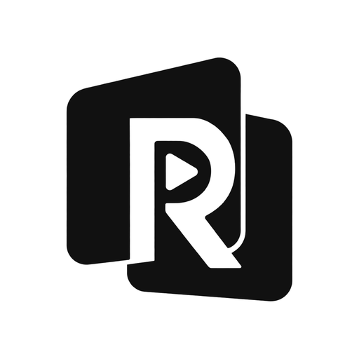
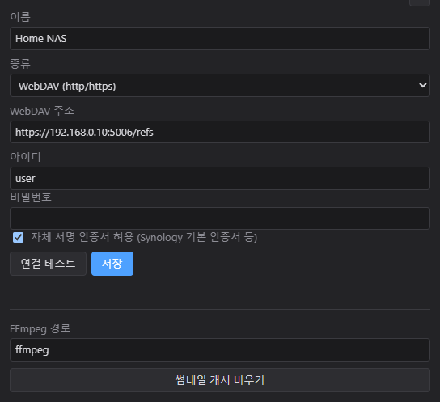

<p align="center"></p>

<p align="center"><a href="README.md">한국어</a> · <b>English</b> · <a href="README.ja.md">日本語</a></p>

# RefBoard

**Put video references from your NAS on a board and watch them in step with the Blender timeline.**

https://github.com/user-attachments/assets/d10ed0c0-4ee2-46a8-a33a-d09a83d5ac70

- **Straight from your NAS**: browse videos on WebDAV (Synology and others) or a local / SMB folder as thumbnails and drag them onto the board.
- **Blender connection**: scrub or play in Blender and the reference follows to the same frame. You can also show it in the viewport or as a camera background.
- Loop ranges, frame-by-frame stepping, flip · crop, drawing, always on top · opacity.

## Download and install

Download from [Releases](../../releases).

| File | Contents |
| --- | --- |
| `RefBoard-Setup-x.y.z.exe` | Windows installer (Windows 10/11, 64-bit) |
| `RefBoard-Blender-Addon-x.y.z.zip` | Blender add-on (Blender 4.2 or later). It is also included in the installer, so you don't need to download it separately |

- The installer is not code-signed, so SmartScreen may warn you the first time. Click **More info ▸ Run anyway**.
- **FFmpeg is required.** If it is on your PATH it is used as is; otherwise set the path to `ffmpeg.exe` in the settings.

  ```bash
  winget install Gyan.FFmpeg
  ```

- On first launch RefBoard asks whether to install the Blender add-on. Click **Install** and it turns on the next time you start Blender.

## Connect your NAS

On first launch, **⚙ Settings** opens. Add a source there.



| Type | Example address |
| --- | --- |
| WebDAV | `https://192.168.0.10:5006/refs` (Synology: WebDAV Server package, HTTPS 5006 / HTTP 5005) |
| Local · SMB folder | `\\NAS\refs`, `Z:\refs` |

## Run and build from source

Requires [Node.js](https://nodejs.org/) 20 or later.

```bash
npm install
```

```bash
npm start
```

Build the release files (created in `dist/`):

```bash
npm run dist
```

```bash
npm run addon
```

## Support

If RefBoard helps you, you can buy me a coffee.

<a href="https://buymeacoffee.com/uho3865"></a>

## License

[MIT](LICENSE)
