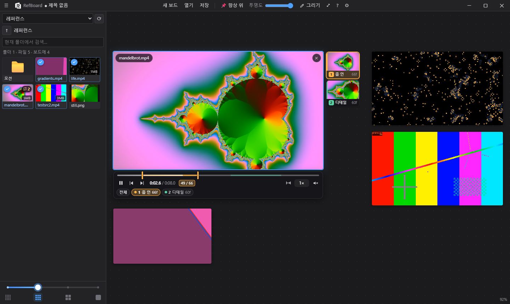
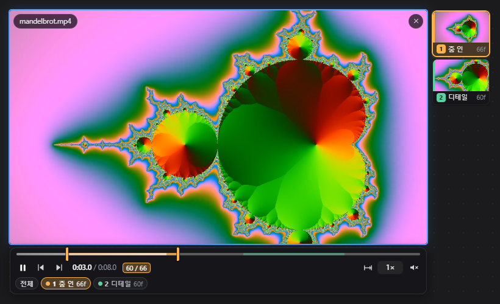
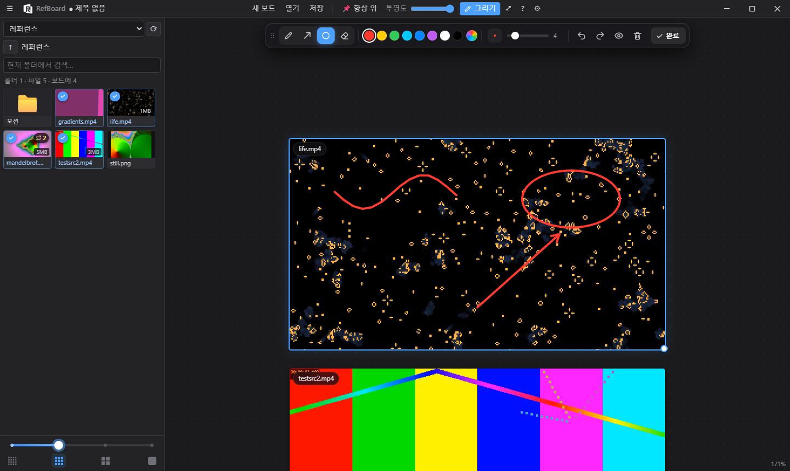
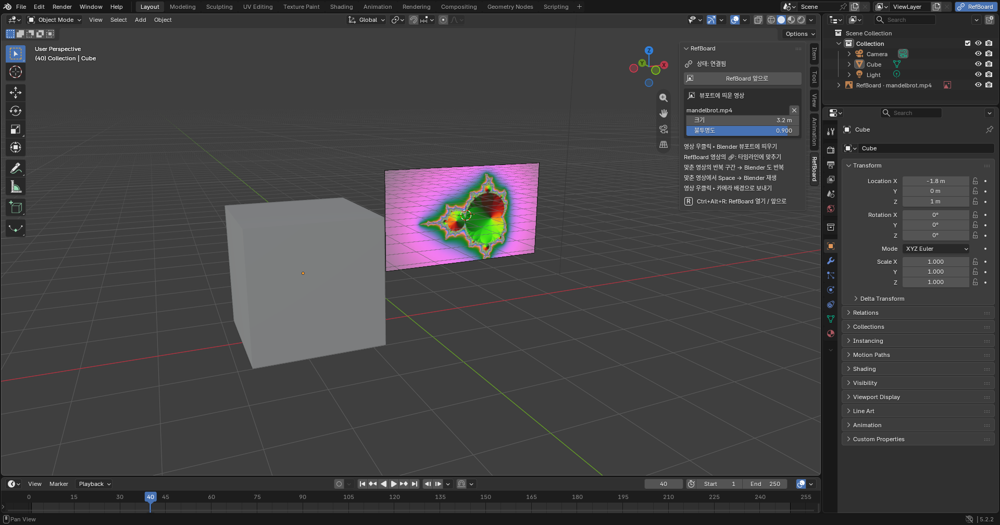

<p align="center"></p>

<p align="center"><a href="README.md">한국어</a> · <b>English</b> · <a href="README.ja.md">日本語</a></p>

# RefBoard

A **video reference board**. Browse videos on a NAS (WebDAV) or a local/SMB folder, put them on a board, and study motion with loop ranges, frame-by-frame stepping and drawing. Connect the **Blender add-on** and the videos follow the Blender timeline.

> The app is available in English, Korean and Japanese. It follows your Windows language on first launch; change it any time in **⚙ Settings ▸ 🌐**. (The Blender add-on's own panel is in Korean for now.)



## Features

- **Infinite board**: drag in videos, GIFs and images and arrange them freely. The board is saved automatically, and you can also save it as a `.refboard` file.
- **NAS browsing**: WebDAV (Synology and others) and local/SMB folders. Thumbnail caching keeps folders with thousands of videos fast.
- **Multiple loop ranges**: name them, keep them per file, and jump to them from range thumbnails.
- **Range library**: organize the ranges you collect with folders / tags and find them by search.
- **Frame-by-frame study**: step one frame at a time at the real fps, change speed, flip horizontally/vertically, grayscale, crop.
- **Drawing**: mark up videos with pen, arrow and circle. Drawings are saved with the board.
- **Always on top · opacity**: float the board over other apps (for example Blender).
- **Languages**: English, 한국어, 日本語 (⚙ Settings ▸ 🌐).
- **Blender connection**: timeline sync, range looping, Space to play, and video in the viewport or as a camera background.

## Download and install

Download from [Releases](../../releases).

| File | Contents |
| --- | --- |
| `RefBoard-Setup-x.y.z.exe` | Windows installer (Windows 10/11, 64-bit) |
| `RefBoard-Blender-Addon-x.y.z.zip` | Blender add-on (Blender 4.2 or later). It is also included in the installer, so you don't need to download it separately |

- The installer is not code-signed, so Windows SmartScreen may warn you the first time. Click **More info ▸ Run anyway**.
- **FFmpeg is required** (for thumbnails and reading fps). If it is on your PATH it is used as is; otherwise set the path to `ffmpeg.exe` in the settings.

  ```bash
  winget install Gyan.FFmpeg
  ```

## First setup: connect your NAS

On first launch, **Settings** opens. Add a source there.


| Type | Example address |
| --- | --- |
| WebDAV | `https://192.168.0.10:5006/refs` (Synology: WebDAV Server package, HTTPS 5006 / HTTP 5005) |
| Local · SMB folder | `\\NAS\refs`, `Z:\refs` |

- Passwords are encrypted with the Windows secure store (DPAPI) and saved in `%APPDATA%\refboard\config.json`.
- If your NAS uses a self-signed certificate (like Synology's default), check **Allow self-signed certificate**.
- A NAS whose disks are asleep can take 10–30 seconds to answer the first request. The panel shows that it is waiting.

## Usage

### Board

- **Drag or double-click** a video in the left panel to open it on the board. You can also drag files straight from Explorer.
- Hover over a video to show its controls. Close it with ✕ or `Delete`.
- The board is saved automatically and restored on the next launch. `Ctrl+S` saves it as a `.refboard` file.
- **Videos on the board are marked** in the panel with a blue check. If the same video is on the board more than once, the count is shown too.
  - Right-click a card for **Show on board** (jumps to that video), add another copy, close all copies, and copy path.
- **Playback bar:** sits right below the reference. It appears on hover or when selected, and keeps the same size at any zoom level.
- **Right-click a video on the board:** create and adjust ranges, pick a range, play, sound, flip/grayscale/crop, locate in panel, close.
- Reference videos always start muted.
- Press `F1` for shortcuts. Space play, ←/→ frame step, `[` `]` loop range, `1`–`9`/`0` pick range, `-` `=` speed, `Ctrl+T` always on top, Tab show/hide panel.

### Loop ranges



- **Create**
  - Set the start with `[` and the end with `]` to create a range. You can also press the range button on the playback bar once at the start and once at the end.
  - Right-click works too (on the progress bar: that point; on the video: the current position).
  - Edges snap to frames, and the frame visible when you press `]` is included.
- **Pick · edit · delete**
  - Click a range chip under the progress bar or press `1`–`9` to loop only that range. The **All** chip or `0` (or `\`) plays everything.
  - While a range loops, press `[` `]` or drag the colored handles on the progress bar to move its start/end.
  - Delete with the × that appears when hovering a chip, or from the chip's right-click menu.
- **Naming:** double-click a chip, press `F2` (looping range), or right-click ▸ Name…. `Enter` saves, `Esc` cancels.
- While a range loops, the frame counter counts within the range (for example 5 / 25).
- **Range thumbnails**
  - Board: a reference with ranges gets a vertical strip of first-frame thumbnails, one per range. Click to loop that range; click again to play everything.
  - Panel: cards of files with saved ranges get a ⟳ count. Click it to expand the range thumbnails under the card; click one to go to that range on the board.
- **Ranges are saved per file.** The same video opened on another board, or later, shows the same ranges.

### Range library

- The **Ranges** tab at the top of the left panel. Every range you make on the board is collected here automatically (at first in **Unsorted**).
- **Folders:** create one with **＋**; right-click a folder for new subfolder / rename / delete. Deleting a folder keeps its ranges and moves them to Unsorted.
  - Drag a range card onto a folder, or right-click it ▸ **Move to folder**. Picking a parent folder also shows the ranges in its subfolders.
- **Tags:** right-click a card ▸ **Tags…** and enter several, separated by commas or spaces. Tags you already use can be added with a click.
- **Find:** the search box looks in range names, file names, tags and folder names. Type `#tag` or click a tag chip at the top to keep only that tag (several = must have all).
- Click a card to loop that range on the board. If the video isn't on the board, it is added and starts at that range.
- The board's range chip menu also has **Tags… / Move to folder…**, and changes made on either side show up on both right away.

### Frames · flip · crop

- **Frame stepping:** the real frame rate of each video (24 / 29.97 / 60 fps, etc.) is read with ffprobe.
  - `←` `→` step exactly one frame; with `Shift`, one second.
  - The playback bar shows the frame number (for example 36 / 96); hover it to see the fps.
- **Flip · grayscale · crop:** work on videos, GIFs and images, and are saved with the board.
  - `Shift+H` flip horizontally, `Shift+V` flip vertically, `Shift+G` grayscale.
  - Press `C` to show the crop area. Drag corners/edges to resize, drag inside to move, and press `Enter` to apply. Right-click ▸ **Remove crop** undoes it.
- **GIF:** uses the same playback bar as videos and keeps each frame's own duration.
  - Turn on **Show all frames** (grid icon on the playback bar, or `G`) to lay frames out in a grid; click one to go to it.

### Drawing



- Press **✎ Draw** at the top or `D` to enter drawing mode.
- Tools: pen (`P`), arrow (`A`), circle (`O`), eraser (`E`). The eraser removes a whole stroke when you rub over it.
- Pick the color in the toolbar; change the width with the slider or `Alt+wheel`. `Ctrl+Z` / `Ctrl+Y` undo and redo. `H` hides/shows drawings.
- Drawings stick to their video, so they follow when you move or resize it.

### Saving network and memory

- Videos added while paused download nothing from the NAS. A thumbnail of that moment is shown, and the video only starts downloading when you play or seek.
- Videos moved off screen pause automatically and resume when they come back.
- After more than 8 seconds off screen, the current frame is kept as a still image and the video is unloaded to free memory.
- The NAS is read over a single connection in 4 MB pieces, so several videos don't stall even on a NAS that is slow to log in new connections.

Supported formats: H.264 / H.265 (HEVC) / VP9 / AV1 (mp4, mov, m4v, webm, mkv). ProRes is not supported.

## Connecting to Blender



Keep using the desktop RefBoard window and connect it to Blender. To keep RefBoard above Blender, use **📌 Always on top** and **Opacity**.

- **Install (automatic):** on first launch, RefBoard finds Blender (4.2 or later) on this PC and asks whether to install the add-on. Click **Install**.
  - The add-on ships inside RefBoard, so there is nothing to download. It is copied into Blender's add-on folder (`%APPDATA%\Blender Foundation\Blender\<version>\scripts\addons`).
  - **It turns on automatically the next time you start Blender.** (A one-time startup script is added alongside it and deletes itself after running.) If Blender was running, restart it.
  - When you update RefBoard, an older installed add-on is replaced with the new version automatically.
  - To do it later, use **⚙ Settings ▸ Install / update Blender add-on**. The install status per Blender version is shown there too.
- **Install (manual):** Blender ▸ Edit ▸ Preferences ▸ Add-ons ▸ ▾ ▸ **Install from Disk…** ▸ choose `RefBoard-Blender-Addon-x.y.z.zip` → enable **RefBoard 연결**.
- **The connection is automatic.** Start RefBoard or Blender in any order; restarting either one reconnects.
  - RefBoard's title bar shows the current Blender frame, and the **RefBoard** button on the right of Blender's top bar shows the connection state.
- **Open RefBoard:** the **RefBoard** button in Blender's top bar, `Ctrl+Alt+R`, or the 3D view sidebar (`N`) ▸ **RefBoard** tab. It starts RefBoard if it isn't running, or brings it to the front.
  - The installed RefBoard is found automatically (always, once RefBoard has run).
- Only one RefBoard runs at a time. The connection stays on this PC (127.0.0.1) and uses a one-time token.

**Sync to the Blender timeline**
- When Blender is connected, a 🔗 button appears on the playback bar of videos and GIFs. Turn it on with 🔗, `L`, or right-click ▸ **Sync to Blender timeline**.
  - "Blender frame = current reference frame" at that moment becomes the sync point.
- Scrub or step in Blender and the reference moves to the matching frame. Sync is **time-based**, so different fps still show the same moment (for example frame 99 of a 29.97 fps video = frame 80 of a 24 fps scene).
- When Blender plays, the reference plays along and slightly adjusts its speed to catch up if it drifts.
- While synced, moving the reference with `←` `→` or dragging the progress bar resets the sync point to that position.
- If a synced reference has a loop range, **Blender's preview range is set to match**, so Blender playback loops the same range.
  - Turning off the range or the sync, or disconnecting, restores the original preview range.
  - If the range start would fall before the scene's start frame, the sync point is reset to "range start = scene start frame". It never goes to negative frames.
- On a synced reference, `Space` or the play button starts and stops **Blender playback**.

**Show in the Blender viewport**
- In RefBoard, right-click a video ▸ **Show in Blender viewport**. It is added as a reference image (Empty) at the 3D cursor, facing front (Front view direction).
- Move, rotate and scale it like any object. Change size and opacity, or remove it, in the sidebar (`N`) ▸ **RefBoard** tab.
- The frame to show is computed every frame the same way as in RefBoard, so it matches RefBoard even with a different fps, playback speed or loop range.

**Send to camera background**
- In RefBoard, right-click a video ▸ **Send to Blender camera background**. It becomes the active camera's background movie clip, visible in camera view (`Numpad 0`).
- NAS videos are downloaded once into `%APPDATA%\refboard\blender-clips`.

## Run from source · build

Requires [Node.js](https://nodejs.org/) 20 or later.

```bash
npm install
```

```bash
npm start
```

- While running from source, a **new version notice** appears at the top when the code changes (off in the installed app).
- Set this folder as **Source folder (development)** in the Blender add-on preferences and the add-on's **Open RefBoard** runs it from source.

Build the release files (created in `dist/`):

```bash
npm run dist
```

```bash
npm run addon
```

Self-test (needs a test WebDAV server or folder):

```bash
npm run selftest
```

Choose the test source with the environment variables `RB_TEST_URL` / `RB_TEST_USER` / `RB_TEST_PASS` (WebDAV), or `RB_TEST_TYPE=local` and `RB_TEST_URL=<folder>`.

To change the logo, replace `assets/logo-source.png` (black logo on white) and run `python scripts/make-icons.py`.

## Support

If RefBoard helps you, you can buy me a coffee.

<a href="https://buymeacoffee.com/uho3865"></a>

## License

[MIT](LICENSE)
